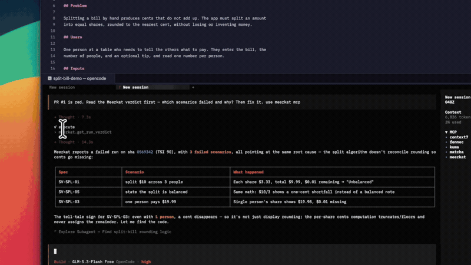
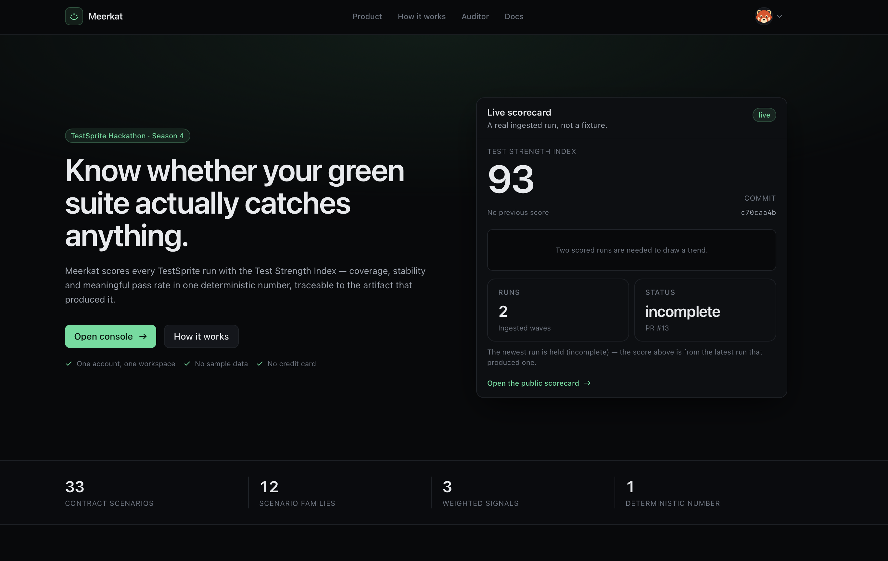
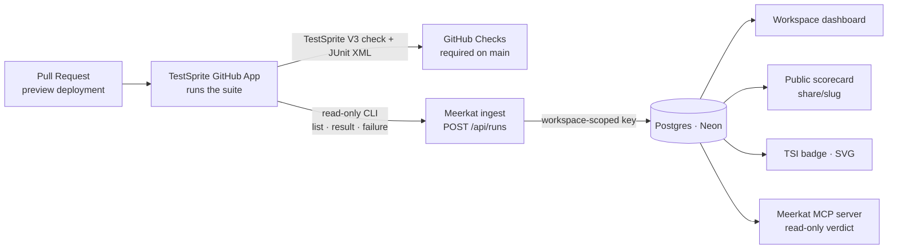
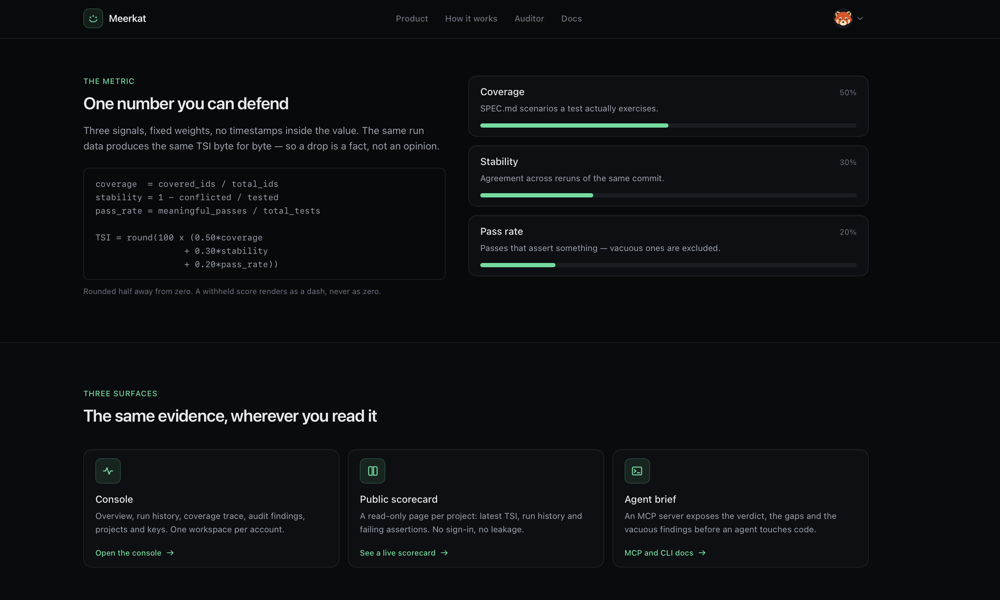
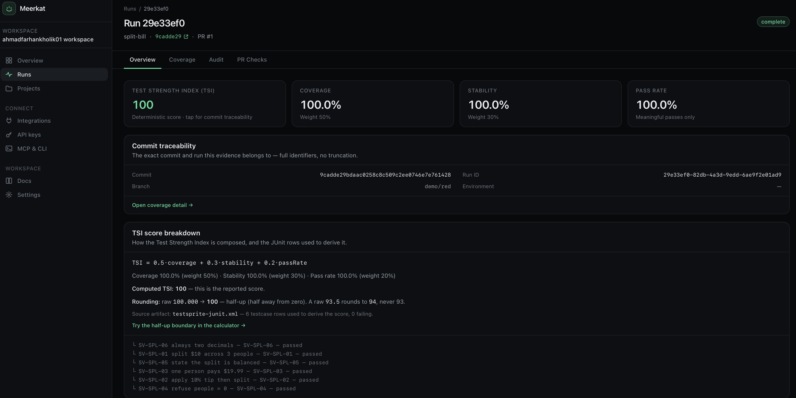
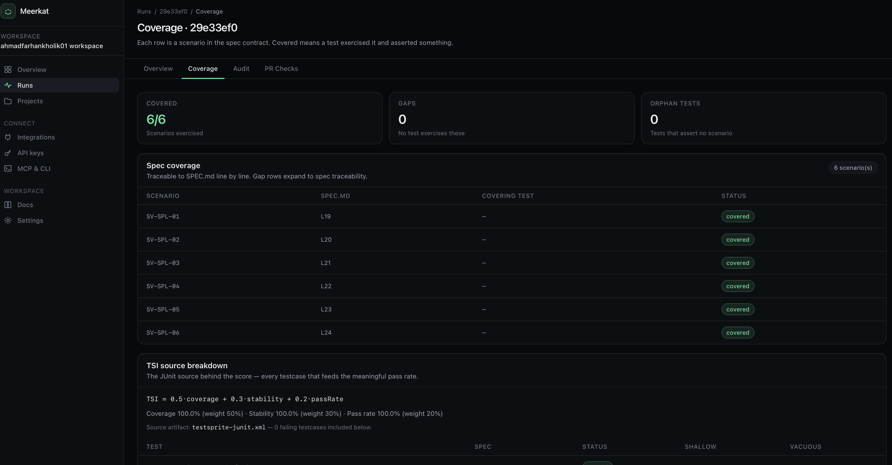
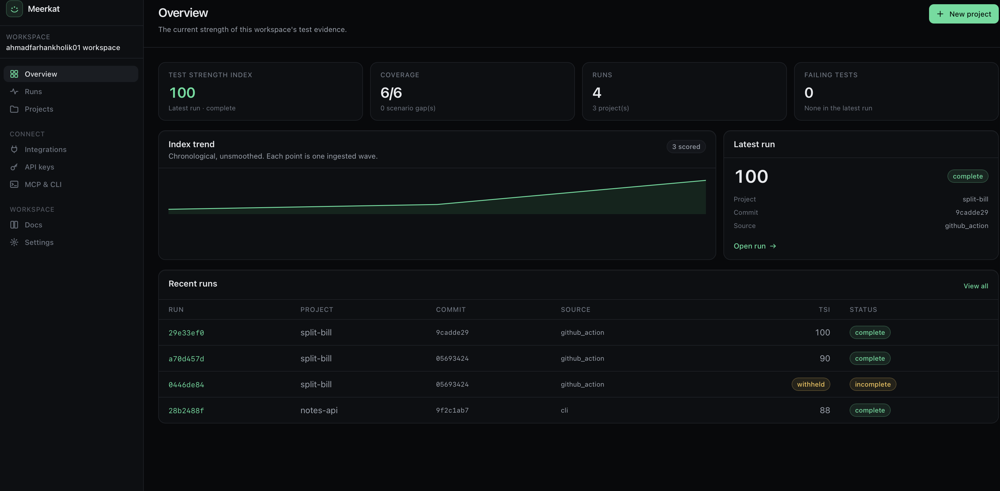

<div align="center">


# Meerkat

### A green checkmark tells you a test ran.<br/>Meerkat tells you whether it *meant* anything.

Meerkat is a **verdict-trust gate for automated test runs**. It ingests a TestSprite wave,
computes a deterministic **Test Strength Index (TSI)**, and surfaces the evidence a green
check hides: coverage by requirement, shallow and vacuous passes, orphans, and whether a
verdict can actually be trusted.

[](https://www.testsprite.com/hackathon-s4)
[](src/lib)
[](https://meerkat-app.vercel.app/share/meerkat-demo)
[](LICENSE)

**[Live app](https://meerkat-app.vercel.app)** · **[Watch the demo](https://youtu.be/Hp3JypVbuJ4)** · **[Public scorecard](https://meerkat-app.vercel.app/share/meerkat-demo)** · demo sign-in `demo@suitevitals.dev` / `demo-password-1`

</div>

<p align="center">
  <a href="https://youtu.be/Hp3JypVbuJ4">
    
  </a>
</p>

<p align="center">
  <a href="https://youtu.be/Hp3JypVbuJ4"><b>▶ Watch the full demo</b></a>
  <sub> — one tiny app, red to green, evidence at every step.</sub>
</p>

<p align="center">
  
</p>

---

## The problem

A passing check proves a test executed. It does **not** prove the test covered the
requirement you just changed, or that it passed because the app is correct — rather than
because the assertion was too weak to ever fail. Teams merge green-looking suites every
day, and agents "fix" code they never understood.

Meerkat sits one layer above the pipeline and answers the question a checkmark can't:

> *Does this passing suite actually match the requirements it was written against?*

## What Meerkat is

| | |
|---|---|
| **A score** | The Test Strength Index — one deterministic number from coverage, stability and meaningful pass rate. |
| **An evidence trail** | Every score traces to the `SPEC.md` line that defines the requirement and the JUnit row that exercised (or missed) it. |
| **A trust gate** | A green verdict is cross-checked before it is trusted. An incomplete or refused run is held, never forced green. |
| **A ledger** | Every wave is recorded, so a human or an agent can see what failed before and not repeat the same mistake. |

It is **multi-tenant** (one account → one workspace → its projects, keys and runs) and
**agent-readable** (an MCP server exposes the verdict, gaps and findings so a coding agent
reads the failure before it touches code).

## How it works

Meerkat is a **consumer of TestSprite's results, not a replacement for them** — one level
higher in the pipeline.



1. **TestSprite** creates and runs the browser suite on each PR's preview deployment and
   posts the required `TestSprite V3` check. Branch protection on `main` keeps every merge
   gated on that green result.
2. **Meerkat** pulls per-test verdicts and failure bundles through free read-only CLI calls
   and posts the wave into Postgres through the key-gated `POST /api/runs` — the same source
   the dashboard, the public scorecard and the badge read from.
3. The run is scored and **audited**, then served three ways: the console, the public
   read-only scorecard, and the MCP server for agents.

## The Test Strength Index

Three signals, one deterministic number — **the same run always scores the same TSI, byte
for byte.**

```
coverage    = covered_ids / total_ids        # SPEC.md scenario IDs ↔ test names
stability   = 1 − conflicted/tested          # < 2 runs of a SHA → 1.0, labelled estimated
pass_rate   = meaningful_passes / total_tests
TSI         = round(100 × (0.50·coverage + 0.30·stability + 0.20·pass_rate))   # half-up
```

<p align="center">
  
</p>

The committed baseline (`SV-TSI-01`: 30/33 coverage, 65/67 stability, 63/67 pass) scores
**93** exactly. Coverage is matched by `SPEC.md` IDs inside test names, so it is a testable
contract, not a guess about file names.

## The Verdict-Trust Gate

A green suite is not automatically trustworthy. Meerkat classifies how each pass is
anchored to the contract and withholds a verdict it cannot stand behind:

- **Vacuous passes** — a test that asserts nothing is excluded, not counted.
- **Shallow passes** — a one-assertion test is flagged, not penalised.
- **Orphans** — a test with no contract ID is reported as uncovered.
- **Held verdicts** — an incomplete or refused run reports `n/a`; the headline is never
  invented where evidence is missing.

When a run is red, the gate names the failing scenarios and links the JUnit row behind
each — so the fix targets the root cause, not a symptom.

<p align="center">
  
</p>

## Coverage you can audit

Every scenario in the contract is a row. `covered` means a test exercised it **and
asserted something** — a gap expands to the `SPEC.md` line it came from, and a test with no
ID is counted as an orphan rather than as coverage.

<p align="center">
  
</p>

## Inside the console

One workspace per account: an index trend across every ingested wave, the latest run with
its commit, and the run history with `complete` / `withheld` states side by side.

<p align="center">
  
</p>

## Architecture

Meerkat runs on **TanStack Start** (React + TypeScript) and is hosted on **Vercel** with a
preview deployment per pull request. Accounts, workspaces, projects, API keys and runs are
stored in **Postgres (Neon)** through **Drizzle ORM**; the UI is styled with **Tailwind CSS
v4** design tokens. Sign-in supports password accounts and GitHub OAuth.

The two halves are deliberately separate. The **scoring engine is pure**: it takes a run
payload and returns a score, with no database, clock or network access, which is why the
same input always produces byte-identical output. The **product layer** is where tenancy
and persistence live: CI posts a run through the workspace-scoped `POST /api/runs`, and the
dashboard, public scorecard and badge all read that same row back.

| Layer | Choice |
|---|---|
| Framework | [TanStack Start](https://tanstack.com/start) (React + TypeScript) |
| Hosting | Vercel, per-PR preview deployments |
| Data | Postgres (Neon) + Drizzle ORM |
| Styling | Tailwind CSS v4 design tokens |
| Engine tests | Vitest + fast-check (property-based) |
| Test ingestion | TestSprite (GitHub App check + read-only CLI reads) |

## What the engine covers

The scoring engine is unit-tested with **Vitest + fast-check** (property-based):

| Area | Focus |
|---|---|
| **TSI** | Formula (fixture → **93**), half-up rounding, determinism, signed delta |
| **JUnit** | Counts, skips, malformed input (throws `parse-error`, never crashes) |
| **Coverage** | Traceability, case-sensitivity, gap / orphan detection |
| **Scoring CLI** | `scoreFromArtifacts` — deterministic score from JUnit + SPEC |

The contract lives in [`SPEC.md`](SPEC.md) and is the oracle for every coverage number
Meerkat reports.

## What the TestSprite suite covers

Generated in the TestSprite 3.0 portal from `SPEC.md` plus per-feature plans, then run
against each PR's preview deployment. **12 families, 33 scenarios**, each a contract with
an exact expected value:

| Family | Scenarios | What it proves |
|---|---|---|
| **Smoke** | `SV-SMK-01` · `SV-SMK-02` | Scorecard renders without login; health answers `200` |
| **Action configuration** | `SV-CFG-01` · `SV-CFG-06` | Default paths resolve; a draft PR still gets a check |
| **JUnit ingest** | `SV-ING-01` · `SV-ING-02` · `SV-ING-04` | Counts from fixture; skips stay in denominator; bad XML is `parse-error` |
| **TSI formula** | `SV-TSI-01` · `SV-TSI-04` · `SV-TSI-06` · `SV-TSI-07` | Fixture scores 93; half-up; byte-identical; signed delta |
| **Assertion depth** | `SV-ADQ-01` · `SV-ADQ-02` · `SV-ADQ-03` | Depth per test; vacuous excluded; shallow flagged |
| **Coverage traceability** | `SV-COV-01` · `SV-COV-04` · `SV-COV-09` | Partial match `30/33`; case-sensitive; all 33 rows + orphans listed |
| **Ratchet** | `SV-RAT-01` · `SV-RAT-03` · `SV-RAT-06` | Drop blocks merge; rise moves baseline; checks stay separate |
| **PR comment** | `SV-PRM-01` · `SV-PRM-02` | Comment carries score + delta; second push edits in place |
| **Verdict trust** | `SV-VDT-01` · `SV-VDT-02` | Refusal ≠ failure; incomplete rerun withholds the score |
| **Spec drift** | `SV-DRF-01` · `SV-DRF-03` | Drift ≠ regression; spec-only PR is neutral |
| **Audit trail** | `SV-AUD-01` · `SV-AUD-02` · `SV-AUD-03` | Score → JUnit rows; gap → SPEC line; provenance pins commit |
| **Auto-remediation loop** | `SV-FIX-01` · `SV-FIX-02` · `SV-FIX-04` · `SV-FIX-06` | Regression fixed → green; refusal never auto-fixed; drift updates test; one attempt then human |

The CI-loop families (ratchet, PR comment, remediation) are exercised by this repository's
workflow; the product families run against the deployed app.

## Honest by design

Meerkat does not invent data. Stability needs two runs of a SHA; with one it reports `1.0`,
labelled *estimated*. A project with no ingested run reads `n/a` — a dash is not a zero, and
a missing run is never rendered as a good one. The public scorecard returns a clean
not-found for private projects — never a login wall, never someone else's data.

What is **proven** vs. still a **hypothesis** is tracked in [`VALIDATION.md`](VALIDATION.md).

## Roadmap — from verdict ledger to quality governance

| Seed shipped today | v2 horizon |
|---|---|
| Failure bundles coalesced by cause | Local-LLM root-cause clustering → ready PRs |
| `gap-to-plans` — SPEC gaps as test plans | Gaps auto-create TestSprite plans, runs auto-fill them |
| TSI trend across PR waves | Per-branch quality line; "coverage grows, TSI must not fall" gate |
| ID-in-name contract matching | Semantic matching to SPEC **intent** when naming drifts |
| Same-SHA stability | Flakiness risk scoring before a test runs |
| Verdict-trust gate | Mutation score: inject bugs, measure catch rate |
| Workspaces, scoped keys, public scorecards | Team roles, quotas, key-usage audit log |

The principle holds: Meerkat governs the pipeline one level above it — it never replaces
the tool that proved the product.

## License

MIT — see [LICENSE](LICENSE). Contribution workflow in [CONTRIBUTING.md](CONTRIBUTING.md).

---

<div align="center">


**A green suite is not the same as a meaningful one.**

*Built for TestSprite Hackathon Season 4 · October 2026*

</div>
